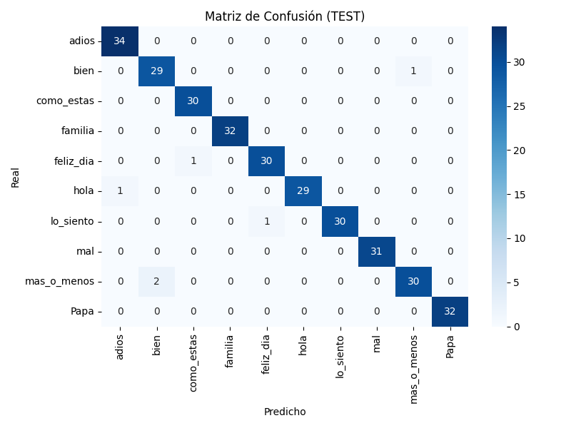

# Colombian Sign Language to Speech

**Ten isolated LSC signs, recognized from webcam video using MediaPipe and a Temporal Convolutional Network with attention.**

An academic computer-vision project by **Juan Sebastián Rodríguez Salazar and Johan Santiago Caro Valencia**, Universidad del Rosario, 2025-I.

[Project report](Vision_final.pdf) · [Model architecture](src/model.py) · [Desktop launcher](run_pipeline.py)

## What it demonstrates

- Capture and temporal normalization of gesture sequences.
- Extraction of 1,662 pose, face and hand keypoints with MediaPipe.
- TCN classification with attention over 15-frame sequences.
- A PyQt5 webcam interface and Spanish speech output using gTTS.
- Evaluation through a confusion matrix, precision–recall curves and latent-space visualization.

This is a recognizer for a fixed vocabulary of isolated signs. It does not implement unrestricted continuous sign-language translation.

## Reported results

| Split | Accuracy | Macro F1 |
| --- | ---: | ---: |
| Project test set | 0.981 | 0.981 |

These are the project's reported experimental results. Generalization to new signers and recording conditions requires separate evaluation.



[Precision–recall curves](Data/Figures/Figure_2.png) · [Latent-space visualization](Data/Figures/Figure_3.png)

## Run the desktop demo

The current launcher uses a Windows-style Qt UI path. Run it from the repository root.

```powershell
git clone https://github.com/JuanSebastianrs/TCN_to_LSC.git
cd TCN_to_LSC
python -m venv .venv
.\.venv\Scripts\Activate.ps1
python -m pip install -r requirements.txt
python run_pipeline.py
```

A webcam, audio output and a TensorFlow-compatible Python environment are required. The declared dependencies include TensorFlow 2.16.1. Speech synthesis through gTTS requires network access.

The trained model and label map are already included:

- [src/models/actions_15.keras](src/models/actions_15.keras)
- [src/models/words.json](src/models/words.json)

No placeholder model-download URL is needed.

## Recognized vocabulary

hola · adiós · bien · mal · más o menos · lo siento · cómo estás · feliz día · familia · papá

Examples of the recorded signs are available in [Data/Figures/](Data/Figures/).

## Training and evaluation code

| File | Purpose |
| --- | --- |
| [src/capture_samples.py](src/capture_samples.py) | Record gesture samples |
| [src/normalize_samples.py](src/normalize_samples.py) | Normalize video sequences |
| [src/create_keypoints.py](src/create_keypoints.py) | Extract MediaPipe keypoints |
| [src/prepare_dataset.py](src/prepare_dataset.py) | Stratified 70/15/15 train/validation/test split |
| [src/training_model.py](src/training_model.py) | Train the TCN |
| [src/confusion_matrix.py](src/confusion_matrix.py) | Classification evaluation |
| [src/plot_pr_curves.py](src/plot_pr_curves.py) | Precision–recall curves |
| [src/latent_tsne_umap.py](src/latent_tsne_umap.py) | Latent-space exploration |

[src/constants.py](src/constants.py) defines the paths used by the scripts. The published sample data is under `Data/`, while training constants refer to folders under `src/`; align those locations before rebuilding the dataset or retraining.

## Credits

Developed by Juan Sebastián Rodríguez Salazar and Johan Santiago Caro Valencia. The capture workflow builds on [ronvidev/modelo_lstm_lsp](https://github.com/ronvidev/modelo_lstm_lsp).

## Resumen en español

Prototipo académico que reconoce diez señas aisladas de Lengua de Señas Colombiana y genera voz en español. Combina visión por computador, modelado temporal y una interfaz de escritorio. El alcance del vocabulario y las condiciones de evaluación se documentan explícitamente.
